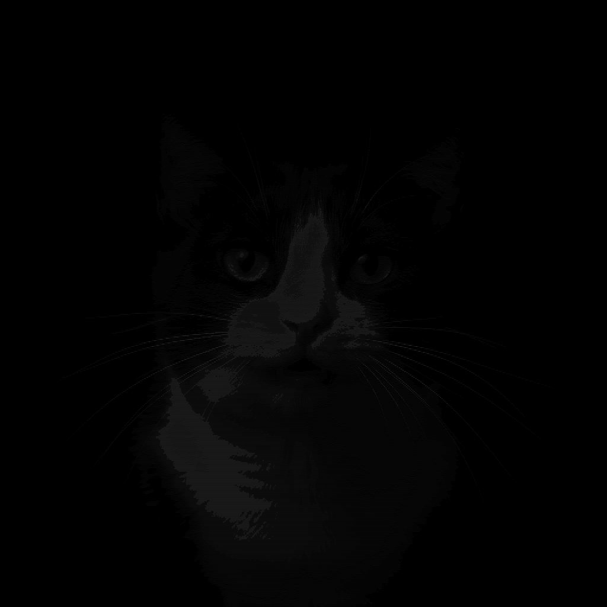
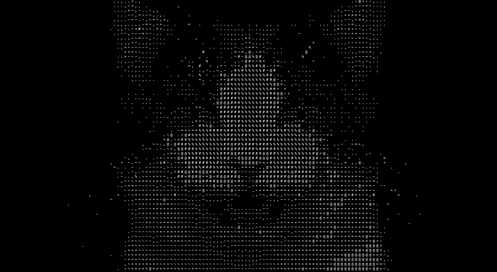

# ASCII & Emoji Video Converter

Convert images and videos to ASCII art or emoji art.

Generated `.txt` output stays local and is ignored by Git; `requirements.txt` is exempt and remains tracked.

Tested on macOS only. Font loading should be updated for other systems.

## Installation

Install the required dependencies:

```bash
pip install -r requirements.txt
```

Or install manually:

```bash
pip install opencv-python pillow==9.5.0 moviepy==1.0.3 tqdm numpy
```

**Note:** This tool requires `ffmpeg` (specifically `ffprobe`) to be installed on your system for reading video rotation metadata. Install it via:

`brew install ffmpeg`

## Usage

```bash
python ascii_video.py <input_video> [options]
```

### Options

- `-o, --output`: Path to output video file (default: input filename with `_ascii` suffix, e.g., `input.mp4` → `input_ascii.mp4`)
- `-f, --fontsize`: Font size - lower values = higher resolution but slower processing (default: 10)
- `-s, --scale`: Output scale factor - 1.0 = original size (default: 1.0)
- `--bg-color`: Background color - accepts color names (e.g., "black", "white") or hex codes (e.g., "#000000") (default: "black")
- `--fg-color`: Foreground color - accepts color names (e.g., "white", "black") or hex codes (e.g., "#FFFFFF") (default: "white")
- `--invert-brightness`: Invert brightness mapping - bright areas become dark characters, dark areas become bright characters
- `--mode`: Character set - `chars` (default), `blocks` (█ ▓ ▒ ░ space), `solidblocks` (█ only), `alphabet`, `digits`, `alphanumeric`, `dots` (braille), or the sub-cell shape sets `quadrants` (2x2), `sextants` (2x3), `octants` (2x4), `wedges` (diagonal) and `wedges-octants` (both, per cell)
- `--preserve-colors`: Preserve original colors from the image/video - ignores fg-color, disables grayscale conversion and brightness normalization
- `--tint`: Tint color to apply when `--preserve-colors` is set - accepts color names or hex codes (e.g., "red", "#FF6600")

### Examples

```bash
# Basic conversion (outputs to input_ascii.mp4)
python ascii_video.py input.mp4

# Custom output filename
python ascii_video.py input.mp4 -o my_ascii_video.mp4

# Higher resolution (smaller font)
python ascii_video.py input.mp4 -f 8

# Scale down the input video
python ascii_video.py input.mp4 -s 0.5

# Custom colors (inverted: white background, black text)
python ascii_video.py input.mp4 --bg-color white --fg-color black

# Custom colors using hex codes
python ascii_video.py input.mp4 --bg-color "#0000FF" --fg-color "#FFFF00"

# Invert brightness mapping
python ascii_video.py input.mp4 --invert-brightness

# Use ASCII block characters
python ascii_video.py input.mp4 --mode blocks

# Sub-cell shapes - 2x4 subpixels per cell, the sharpest mode
python ascii_video.py input.mp4 --mode octants

# Diagonal wedges - smoother slanted edges
python ascii_video.py input.mp4 --mode wedges

# Preserve original colors
python ascii_video.py input.mp4 --preserve-colors

# Preserve colors with a tint
python ascii_video.py input.mp4 --preserve-colors --tint red
python ascii_video.py input.mp4 --preserve-colors --tint "#FF6600"
```

`solidblocks` fills every opaque cell with `█`, regardless of brightness.
Use `--ansi-colors` (or `--ansi-fg-only`) for colored text, or `--preserve-colors`
for image/video output, to make a mosaic of solid cells in the source colors.
Transparent text cells remain spaces. Without color output, all opaque cells
use the same foreground; `--invert-brightness` does not change the solid glyph.

```bash
python ascii_image.py cyberd.png --mode solidblocks --ansi-fg-only --adjust-aspect-ratio --transparent-bg -o cyberd_solid.txt -s 3
```

### Sub-cell shape modes

`quadrants`, `sextants` and `octants` split every cell into a grid of subcells
(2x2, 2x3, 2x4) and pick the character matching the lit pattern, so a cell
carries shape instead of just brightness - 8x the detail at the same grid size.
Image and video output draws these glyphs directly, no font needed.
`.txt` output is plain text unless `--ansi-colors` is set, which gives each
cell a foreground and a background color - so a single cell can hold two colors.
`--ansi-fg-only` emits foreground codes alone, leaving unlit subcells on the
terminal background; use it for readers that ignore `48;` codes.

`wedges` uses the block diagonals (U+1FB3C-U+1FB67) plus the triangular quarter
blocks instead: each glyph is a corner of the cell cut off by a straight line at
an arbitrary angle. A rectangular grid quantises every edge to its own subcells,
so slanted contours - jawlines, hair, silhouettes - come out stair-stepped;
a wedge follows the angle instead. The trade is the reverse: wedges are poor at
fine isotropic texture, where the rectangular grids win. `wedges-octants` fits
both alphabets to every cell and keeps whichever leaves the smaller error.

Both fit a cell as a two-tone split: the glyph, and the mean color on each side
of its edge. Cells too flat to split stay solid, so smooth areas do not turn
into noise.

For `.txt` output the terminal has to render them:

| Mode | Range | Support |
|---|---|---|
| `quadrants` | U+2580 block elements | everywhere |
| `sextants` | U+1FB00 | terminals that draw block glyphs themselves (Ghostty, kitty, foot, WezTerm) |
| `octants` | U+1CD00, Unicode 16 | same, recent versions only |
| `wedges` | U+1FB3C-U+1FB6F | same as `sextants` |
| `wedges-octants` | both of the above | same as `octants` |

Those terminals ignore the font for these ranges. Anywhere else you need a font
covering U+1FB00/U+1CD00 (GNU Unifont has both) or the glyphs show up as `?`.

### Example Output

Side-by-side comparison video (original vs ASCII):

[demo/cat_src_collage.mp4](demo/cat_src_collage.mp4)

Demo video: https://youtu.be/g1qp1b4tuAM

## ASCII Image Converter

Convert single images to ASCII art images.

### Usage

```bash
python ascii_image.py <input_image> [options]
```

### Interactive terminal preview

```bash
python ascii_image_tui.py input.png
# Start with any of the image converter's options:
python ascii_image_tui.py input.png --mode octants --ansi-fg-only --adjust-aspect-ratio -s 2
```

Install dependencies from `requirements.txt` first (the TUI uses Textual).
The header contains a mode selector, scale and font-size editors, color/tint
fields, and checkboxes for every boolean flag. Changes automatically refresh
the scrollable preview below; ANSI colors are displayed as colors. Use Tab to
move between controls, Space to toggle checkboxes, and arrows or the mouse to
scroll the focused preview. Large previews scroll horizontally without wrapping.

Edit **Save as** and click **Save** or press **Ctrl+S** to write the current
preview as UTF-8 text, including ANSI escapes when enabled. The default is the
input image path with its extension replaced by `.txt`; `-o` overrides it.
Existing files require a second Save to replace them. **Ctrl+Q** quits.

As in CLI text output, `--preserve-colors` only affects image output; use
`--ansi-colors` or `--ansi-fg-only` to color text. BG and FG set the preview's
base colors, while plain text files contain only characters. Tint applies to
ANSI-colored text. Newer shape glyphs require a terminal that supports them
(see the sub-cell shape modes section above).

### Options

- `-o, --output`: Path to output image file (default: input filename with `_ascii` suffix, e.g., `input.jpg` → `input_ascii.jpg`)
- `-f, --fontsize`: Font size - lower values = higher resolution but slower processing (default: 10)

  
- `-s, --scale`: Output scale factor - 1.0 = original size (default: 1.0)
- `--bg-color`: Background color - accepts color names (e.g., "black", "white") or hex codes (e.g., "#000000") (default: "black")
- `--fg-color`: Foreground color - accepts color names (e.g., "white", "black") or hex codes (e.g., "#FFFFFF") (default: "white")
- `--invert-brightness`: Invert brightness mapping - bright areas become dark characters, dark areas become bright characters
- `--mode`: Character set - `chars` (default), `blocks` (█ ▓ ▒ ░ space), `solidblocks` (█ only), `alphabet`, `digits`, `alphanumeric`, `dots` (braille), or the sub-cell shape sets `quadrants` (2x2), `sextants` (2x3), `octants` (2x4), `wedges` (diagonal) and `wedges-octants` (both, per cell)
- `--preserve-colors`: Preserve original colors from the image/video - ignores fg-color, disables grayscale conversion and brightness normalization
- `--tint`: Tint color to apply when `--preserve-colors` is set - accepts color names or hex codes (e.g., "red", "#FF6600")
- `--adjust-aspect-ratio`: For `.txt` output, compensate for the ~1:2 terminal cell aspect so the result is not stretched
- `--ansi-colors`: For `.txt` output, emit 24-bit ANSI color codes from the source - shape modes color lit and unlit subcells separately
- `--ansi-fg-only`: Like `--ansi-colors` but foreground only, for consumers that ignore background codes
- `--transparent-bg`: Render glyphs on a transparent background, retaining input transparency and antialiased edges. Overrides `--bg-color`; image output requires PNG, WebP or TIFF and defaults to `<input>_ascii.png`. For `.txt`, keeps blank cells as spaces and omits ANSI background colors. With `--ansi-fg-only`, opaque solid areas retain their foreground color. Existing source alpha is respected. If the input has no alpha channel, every pixel with exactly the same RGB color as the top-left pixel becomes transparent, including enclosed regions. Matching happens before scaling or aspect correction, for both image and text output. Text cells that are mostly transparent become spaces. Similar but different colors (including JPEG compression variations) are not matched.

### Examples

```bash
# Basic conversion (outputs to input_ascii.jpg)
python ascii_image.py input.jpg

# Custom output filename
python ascii_image.py input.jpg -o my_ascii_image.png

# Transparent background (outputs to input_ascii.png)
python ascii_image.py input.jpg --transparent-bg

# Higher resolution (smaller font)
python ascii_image.py input.jpg -f 8

# Scale down the input image
python ascii_image.py input.jpg -s 0.5

# Custom colors (inverted: white background, black text)
python ascii_image.py input.jpg --bg-color white --fg-color black

# Custom colors using hex codes
python ascii_image.py input.jpg --bg-color "#0000FF" --fg-color "#FFFF00"

# Invert brightness mapping
python ascii_image.py input.jpg --invert-brightness

# Use ASCII block characters
python ascii_image.py input.jpg --mode blocks

# Sub-cell shapes - 2x4 subpixels per cell, the sharpest mode
python ascii_image.py input.jpg --mode octants

# Diagonal wedges, or wedges and octants competing per cell
python ascii_image.py input.jpg --mode wedges
python ascii_image.py input.jpg --mode wedges-octants

# Preserve original colors
python ascii_image.py input.jpg --preserve-colors

# Colored terminal output
python ascii_image.py input.jpg -o out.txt --mode octants --ansi-colors --adjust-aspect-ratio

# Preserve colors with a tint
python ascii_image.py input.jpg --preserve-colors --tint orange
python ascii_image.py input.jpg --preserve-colors --tint "#00FF00"
```

### Example Output

Example images created with `-f 5`:

**Original → ASCII Art:**

 → 

 → 

## Emoji Image Converter

Convert images to emoji art by matching colors.

### Usage

```bash
python emoji_image.py <input_image> [options]
```

### Options

- `-o, --output`: Path to output image file (default: input filename with `_emoji` suffix)
- `-e, --emoji-size`: Emoji size in pixels (default: 32)
- `-s, --scale`: Input scale factor (default: 1.0)
- `--bg-color`: Background color (default: "black")
- `--emoji-set`: Emoji set to use: `all`, `smiles`, `food`, `animals` (default: all)

### Examples

```bash
# Basic conversion
python emoji_image.py input.jpg

# Larger emojis
python emoji_image.py input.jpg -e 64

# Use only food emojis
python emoji_image.py input.jpg --emoji-set food

# Use smiley faces
python emoji_image.py input.jpg --emoji-set smiles

# Scale down input for faster processing
python emoji_image.py input.jpg -s 0.5 -e 32
```

## Emoji Video Converter

Convert videos to emoji art videos.

### Usage

```bash
python emoji_video.py <input_video> [options]
```

### Options

- `-o, --output`: Path to output video file (default: input filename with `_emoji` suffix)
- `-e, --emoji-size`: Emoji size in pixels (default: 32)
- `-s, --scale`: Input scale factor (default: 1.0)
- `--bg-color`: Background color (default: "black")
- `--emoji-set`: Emoji set to use: `all`, `smiles`, `food`, `animals` (default: all)

### Examples

```bash
# Basic conversion
python emoji_video.py input.mp4

# Use animal emojis
python emoji_video.py input.mp4 --emoji-set animals

# Smaller emojis for more detail
python emoji_video.py input.mp4 -e 20

# Scale down for faster processing
python emoji_video.py input.mp4 -s 0.5
```

**Note:** Emoji rendering uses Apple Color Emoji font (macOS). Valid font sizes are 20, 32, 40, 48, 52, 64, 96, 160. Other sizes will use the nearest valid size and scale.
