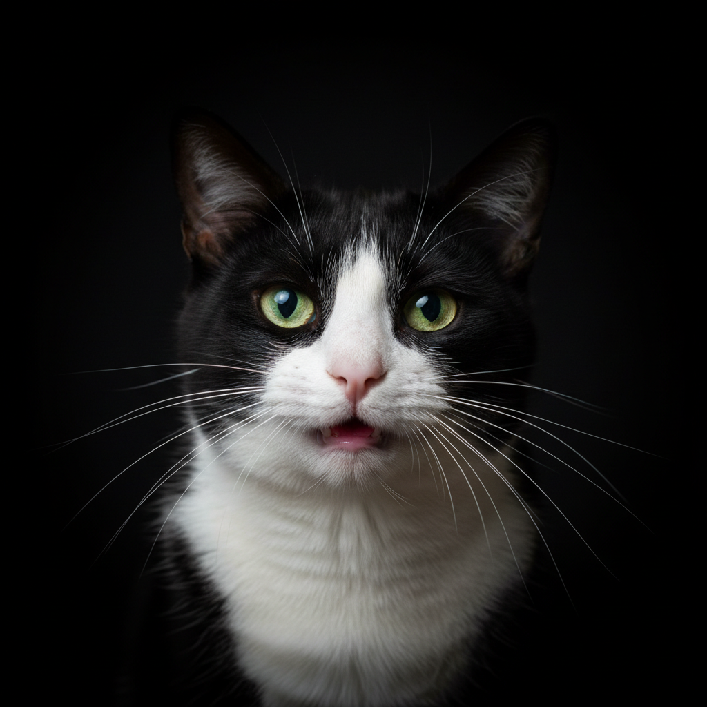
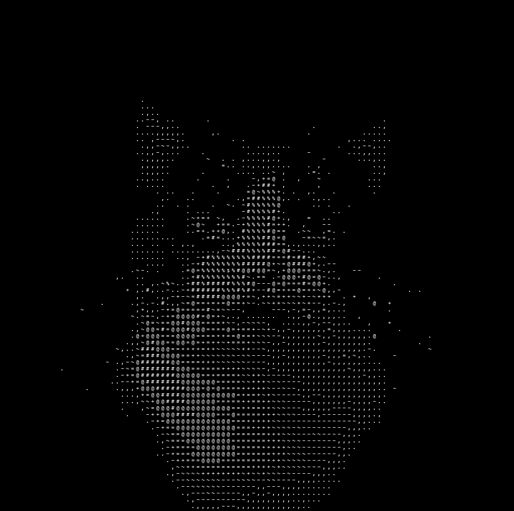
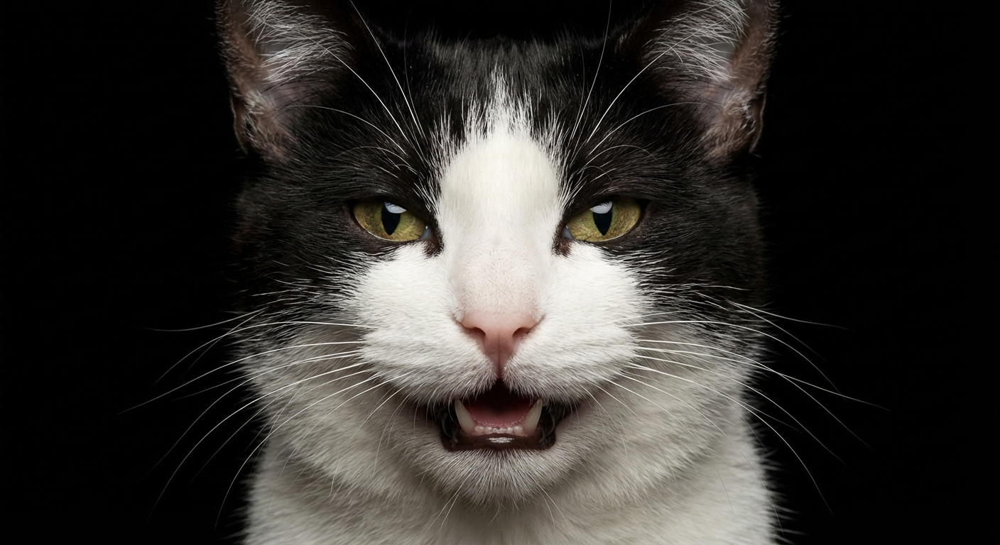

# ASCII & Emoji Art Converter

Convert images and videos to ASCII or emoji art. Image converters can also save
UTF-8 text, and the interactive ASCII preview lets you adjust settings before
saving.

## Installation

Run the commands from the repository root using Python 3.11.3, the version in
`.python-version`. The project is tested on macOS.

```bash
python3 -m venv venv
source venv/bin/activate
python -m pip install -r requirements.txt
```

For video conversion, install FFmpeg and make sure `ffprobe` is on your
`PATH`. Both video converters use it to read rotation metadata. On macOS,
install FFmpeg with `brew install ffmpeg`.

ASCII rendering tries Menlo and falls back to Pillow's default font. Emoji
rendering tries Apple Color Emoji, then
`/usr/share/fonts/truetype/noto/NotoColorEmoji.ttf`. On macOS, if the requested
font size fails to load, the renderer retries the closest of 20, 32, 40, 48,
52, 64, 96, and 160 pixels. Raster emoji tiles are resized to the requested
`--emoji-size`.

## Quick start

Replace `input.png` and `input.mp4` with your own files. Add `--help` to a
converter or the interactive preview to see its accepted arguments.

| Task | Command | Output |
| --- | --- | --- |
| Convert an image to ASCII | `python ascii_image.py input.png --mode blocks` | `input_ascii.png` |
| Convert a video to ASCII | `python ascii_video.py input.mp4 --mode octants` | `input_ascii.mp4` |
| Save plain ASCII text | `python ascii_image.py input.png --adjust-aspect-ratio -o art.txt` | `art.txt` |
| Preview ASCII art in the terminal | `python ascii_image_tui.py input.png` | Saves to `input.txt` on request |
| Convert an image to emoji art | `python emoji_image.py input.png --emoji-set food` | `input_emoji.png` |
| Save emoji text | `python emoji_image.py input.png --emoji-set food -o emoji.txt` | `emoji.txt` |
| Convert a video to emoji art | `python emoji_video.py input.mp4 --emoji-set animals` | `input_emoji.mp4` |

The conversion scripts default to the input directory and extension, adding
`_ascii` or `_emoji` to the filename. Transparent ASCII images default to
`_ascii.png`. Image and video dimensions are rounded down to whole cells.
Video output uses H.264 at the source frame rate and encodes any source audio
as AAC. Both video scripts hold rendered frames in memory, so `--scale 0.5`
can help with larger clips. Git ignores generated `.txt` art.

## ASCII options

These options apply to `ascii_image.py` and `ascii_video.py`.

| Option | Default | Effect |
| --- | --- | --- |
| `-o`, `--output` | Derived from the input path | Choose an output file. For images, use a `.txt` extension to save UTF-8 text. |
| `-f`, `--fontsize` | `10` | Set the glyph size. Smaller sizes fit more characters into the same image. |
| `-s`, `--scale` | `1.0` | Resize the input before rendering. Use `0.5` for half-size input. |
| `--mode` | `chars` | Select the glyph set. See [ASCII modes](#ascii-modes). |
| `--bg-color`, `--fg-color` | `black`, `white` | Set raster colors using names or quoted hex values such as `"#FF6600"`. |
| `--invert-brightness` | Off | Reverse which areas map to light and dark glyphs. |
| `--preserve-colors` | Off | Sample source colors for raster glyphs and use `--bg-color` behind them. |
| `--tint` | Off | Multiply sampled colors by a color name or quoted hex value. Applies to raster output with `--preserve-colors` and to ANSI-colored text. |

```bash
python ascii_video.py input.mp4 --preserve-colors --tint "#FF6600" -s 0.5 -o tinted.mp4
python ascii_image.py input.png --bg-color white --fg-color black -o monochrome.png
```

### ASCII modes

| Mode | Glyphs or layout |
| --- | --- |
| `chars` | A brightness ramp of ASCII symbols |
| `blocks` | Space and shaded blocks `░▒▓█` |
| `solidblocks` | A full block `█` in every opaque cell, independent of brightness and inversion |
| `alphabet`, `digits`, `alphanumeric` | Brightness ramps using letters, digits, or both |
| `dots` | A brightness ramp using Braille dot patterns |
| `quadrants`, `sextants`, `octants` | Rectangular grids of 2×2, 2×3, and 2×4 subcells |
| `wedges` | Diagonal and triangular shapes for slanted edges |
| `wedges-octants` | Chooses the best fit from the wedge and octant shapes for each cell |

Shape modes can capture edges within a single character cell. Raster output
draws the shapes directly and uses the font metrics to size cells. For text
output, the terminal or font must support the glyphs. Octants include Unicode
16 block characters. If glyphs display as boxes, try `quadrants` or `blocks`.

Use `solidblocks` with `--preserve-colors` for a raster mosaic or with
`--ansi-fg-only` for a terminal mosaic.

### Text output and transparency

The shared CLI help lists the aspect-ratio and ANSI flags for both ASCII
converters. They affect image-to-text conversion and the interactive preview.

| Option | Effect |
| --- | --- |
| `--adjust-aspect-ratio` | Compensate for terminal character cells roughly twice as tall as they are wide. |
| `--ansi-colors` | Embed 24-bit color escapes. Shape modes can use separate colors for foreground and background within each cell. |
| `--ansi-fg-only` | Enable ANSI color and emit foreground codes only, leaving the terminal background visible wherever the glyph has no ink. |
| `--transparent-bg` | For ASCII images, render a transparent background and retain antialiased glyph edges. Supports PNG, WebP, and TIFF. For text, keep transparent cells as spaces and emit foreground colors only when ANSI is enabled. |

With `--transparent-bg`, the converter uses the source alpha channel when
present. Otherwise it makes every exact RGB match to the original top-left
pixel transparent, including enclosed regions. This happens before scaling or
aspect correction. Mostly transparent cells become spaces in text output.
Text output also respects source alpha when the flag is off.

```bash
python ascii_image.py input.png --mode octants --ansi-colors --adjust-aspect-ratio -o art.txt
python ascii_image.py input.png --mode solidblocks --ansi-fg-only --transparent-bg -o mosaic.txt
python ascii_image.py input.jpg --transparent-bg -o transparent.png
```

### Interactive ASCII preview

```bash
python ascii_image_tui.py input.png --mode octants --ansi-fg-only --adjust-aspect-ratio -s 2
```

The preview accepts the image converter's options as initial settings. Change
the mode, scale, font size, or colors to refresh the scrollable preview. Use
**Tab** to move between controls, **Space** to toggle checkboxes, and the arrow
keys or mouse to scroll. BG and FG set the preview's base colors. Use the ANSI
options to include color in the saved text.

Edit **Save as** or use `-o` to choose a filename. Click **Save** or press
**Ctrl+S** to write the current preview as UTF-8 text. A filename without an
extension gets `.txt` appended. For an existing file, press **Save** a second
time to overwrite it. Press **Ctrl+Q** to quit.

## Emoji options

Both emoji converters match each cell to the emoji with the closest average
color. With `emoji_image.py -o emoji.txt`, the output is a plain UTF-8 grid of
emoji. The viewer supplies the font used to display them.

| Option | Default | Effect |
| --- | --- | --- |
| `-o`, `--output` | Derived from the input path | Choose an output file. For images, use a `.txt` extension to save emoji text. |
| `-e`, `--emoji-size` | `32` | Set the square cell size in pixels. Smaller sizes fit more emoji. |
| `-s`, `--scale` | `1.0` | Resize the input before matching colors. |
| `--bg-color` | `black` | Set the tile background for images and videos using a color name or quoted hex value. |
| `--emoji-set` | `all` | Choose `smiles`, `food`, `animals`, or `all` three sets. |

```bash
python emoji_image.py input.png --emoji-set food -e 64 --bg-color white -o food.png
python emoji_video.py input.mp4 --emoji-set animals -e 20 -s 0.5 -o animals.mp4
```

## Demos

Original images and their ASCII conversions at `-f 5`.

 → 

 → 


[Side-by-side comparison video](demo/cat_src_collage.mp4) · [Demo video on YouTube](https://youtu.be/g1qp1b4tuAM)

## Development

Install pytest separately and run the test suite from the repository root.

```bash
python -m pip install pytest
python -m pytest -q
```

Use `measure_brightness.py` to sort glyphs from darkest to lightest when
building a character ramp.

```bash
python measure_brightness.py --show-values -f 10 . + '@' '#'
```
